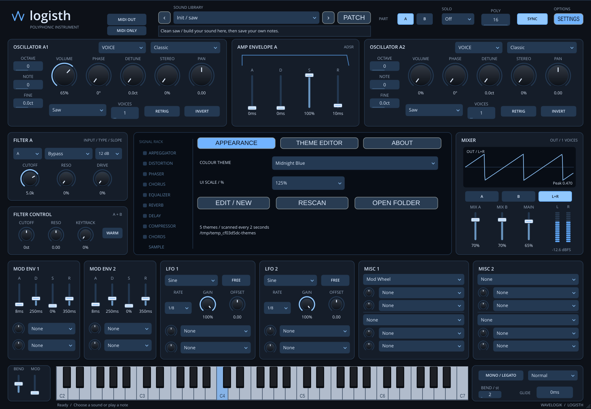

# logisth 0.9.1

**wavelogik logisth — a two-part polyphonic subtractive synthesizer with a compact single-window console.**
VST3, CLAP and Standalone for Windows, macOS and Linux. Built with JUCE and an
independent synthesis engine; not affiliated with LennarDigital.



## Fixed in 0.9.1

- PHASE is available in A1/A2/B1/B2 Classic and Wavetable with RETRIG off or on.
- The knob applies a live phase offset, including held notes and host automation.
  RETRIG controls whether new notes start at a fixed or random phase.
- Knob changes use a short cyclic smoothing ramp; 0/360 degrees are equivalent,
  and crossing the boundary takes the short path. Phase modulation remains additive.

## New in 0.9.0

- Manufacturer: **wavelogik**; product: **logisth**. Original code/documentation
  use the MIT license. Plug-in metadata uses `com.wavelogik.logisth` and the new
  manufacturer code; hosts see a new instrument identity. Existing .logisth
  sound presets remain readable.
- SETTINGS / APPEARANCE remembers exact window dimensions and typed scaling
  from **80–200%**, including decimals. The last percentage remains visible and
  new/reopened instances restore it. Resizing does not affect the audio patch.
- Five standard themes are written as editable JSON files in the user's
  `logisth/themes` folder. Theme Editor previews all ten palette roles, accepts
  RGB hex colours, and saves custom copies. Open Folder and Rescan are available;
  automatic scans discover installed/edited files every two seconds.
- REVERB adds **Room, Spring, Vintage and Shimmer** alongside Hall. Room has
  early reflections, Spring uses dispersive all-passes, Vintage has filtered,
  saturated feedback and wow/flutter, and Shimmer uses granular pitch-shifted
  feedback/excitation. Relevant Decay, Dispersion, Wow/Flutter and Shimmer/Pitch
  controls appear for their respective modes. Type changes crossfade over 100 ms.
- 581 automatable audio parameters; the six new reverb IDs are appended.

[Theme editor](docs/images/logisth-theme-editor.png) ·
[Shimmer controls](docs/images/logisth-reverb-shimmer.png) ·
[About / licenses](docs/images/logisth-about.png) · [Theme file format](docs/THEMES.md)

## Fixed in 0.8.1

- Zero attack/decay now enters the requested sustain immediately. An all-zero
  ADSR produces silence instead of a single full-amplitude sample.
- Part and optional oscillator amplitude envelopes have a short (~1 ms)
  anti-click edge, including zero Release. Steady-state gain remains unchanged;
  modulation envelopes retain instantaneous zero-time transitions.
- [Anti-click regression notes](docs/ANTICLICK.md).

## New in 0.8.0

- WT Pos / Start targets A1, A2, B1 and B2 individually, plus A, B and A+B groups.
- Fresh instances open Init / saw: one classic saw, bypassed filters, no effects
  or modulation, and Main at 65%. Saved project/preset Main values remain intact.
- Editable preset comments under the sound selector are embedded in .logisth files
  and host state (up to 4096 characters).
- SETTINGS contains five themes and About. Midnight Blue, Cobalt, Graphite and
  Forest are dark; Light remains available. The selected theme is a persistent
  user preference shared by instances and independent of the loaded sound.
- The ADSR preview uses actual segment times: 0 ms attack is vertical, and longer
  attack values occupy more of the time axis.

[Midnight Blue](docs/images/logisth-dark.png) · [Cobalt](docs/images/logisth-cobalt.png) ·
[Graphite](docs/images/logisth-graphite.png) · [Forest](docs/images/logisth-forest.png) ·
[Light](docs/images/logisth-light.png)

## New in 0.7.1

- Unison detune extends to 0–100 cents in A1/A2/B1/B2, displayed in ct.
- LFO routing identifies wavetable scanning as WT Pos / Start A, B or A+B.
  Both LFOs and both route slots support it; the wavetable view follows the
  modulated frame. See the English manual for a step-by-step setup.

## New in 0.7.0

- WT POS selects one periodic cycle from a bank of up to 256 frames; the factory
  bank contains 128 waves. A stacked waveform view highlights the playing frame
  and displays its number. Drag the window or use the wheel to select a frame.
- Auto wavetable import reads Serum WAV CLM cycle lengths, with a 2048-point
  fallback and short single-cycle detection. Manual lengths: 128–4096 samples.
- Graphs arp is removed. Legacy and the seven-row Pattern engine remain, with
  twelve A–L pattern memories, latch, MIDI output and MIDI-only operation.
- Oscillator menus show only pages valid for the selected engine and grain model.
  Sampler no longer exposes Granulizer pages or periodic-oscillator phase controls.
- 575 automatable parameters. The removed Graphs parameter block is not reserved;
  this update does not preserve the removed Graphs automation parameters.

## New in 0.6.0

- Calibrated source bus: one centred full-scale sine reaches 0 dBFS peak per
  channel before effects and at unity Main. Shared effects receive that same
  reference; there is no hidden attenuator, reciprocal boost or startup fade.
- Factory Main trims provide headroom; the mixer displays output dBFS.
- Drop audio directly onto the large SAMPLE waveform or its header to load
  the selected A1/A2/B1/B2 slot. Successful Classic drops select Sampler;
  invalid files leave the source and mode intact.
- No fixed sample-duration limit. Active imported stereo PCM has a 512 MiB
  aggregate memory budget; portable state/presets allow up to 1 GiB.
- Long-file waveform peaks are computed on the import worker for fast zoom/pan.
- [Calibration report](docs/CALIBRATION.md), independent reference WAV, rendered
  sine and calibration preset are included with the release.

Levels and effect drive have been recalibrated together. Existing patches may
sound different; use the new factory presets and check Main when loading older
sounds. Parameter IDs remain stable; preserving old sound is not the objective.

## Fixed in 0.5.1

- Buttons and menus stay stable between GUI refreshes; Retrig, Invert and the
  arp enable switch respond to each click.
- The arp playhead clears on disable in all three engines; latch, sustain and
  scheduled notes are checked by regression tests.
- Larger embedded text, a minimum 11 px base font and taller popup menu rows.
- Press/refresh/release tests cover both parts and both themes, plus audio
  checks for retrigger phase and inversion polarity.

## What's new in 0.5.0

- Granulizer model with separate grain/wave spacing, attack/hold, alternating
  pan, wave-spacing LFO, randomness, transient regions/detection, key mapping,
  time hold, reverse and tempo stretching. Previous Cloud model remains available.
- Large sample waveform with a live scanner and grain positions, zoom and seek.
- Mixer oscilloscope: part A, part B or actual final L+R sum.
- Earlier releases included an experimental Graphs arp, removed in 0.7.0.
  Twelve A–L pattern memories remain available for Legacy and Pattern.
- User preset library: save/load/delete .logisth files with embedded audio,
  chords, all patterns and UI preferences. 581 current automatable audio parameters.
- Compact single-window interface with light/dark themes.

[English manual](docs/MANUAL.md) · [PDF manual](docs/logisth-Manual-English.pdf) ·
[Implementation references](docs/STUDIO-0.5.md) ·
[Download 0.9.1](https://github.com/logik93/logisth/releases/tag/v0.9.1)

Native archives are built and tested on Windows, macOS and Linux. Each package
contains the English manual and build metadata. Publication requires all platform
builds and tests to pass.
Cthulhu and Fruity Granulizer manuals supply behaviour references. logisth uses
its own implementation and graphics and does not import their proprietary presets.

## Install

Extract your OS archive and copy the complete VST3 and CLAP bundles to your DAW's
scan directories. Rescan and insert **logisth** on a MIDI instrument track.

| System | VST3 user path | CLAP user path |
| --- | --- | --- |
| Windows x64 | `%LOCALAPPDATA%\Programs\Common\VST3` | `%LOCALAPPDATA%\Programs\Common\CLAP` |
| macOS Universal | `~/Library/Audio/Plug-Ins/VST3` | `~/Library/Audio/Plug-Ins/CLAP` |
| Linux x64 | `~/.vst3` | `~/.clap` |

Add the user path to your host if necessary. Standalone includes audio/MIDI device
settings. macOS requires 11+, includes x86_64 and arm64, and is signed ad-hoc
without notarization. Windows is unsigned. Linux requirements and test results
are recorded in each archive's BUILD_INFO.json. VST2 is not included without a
separately licensed SDK.

## Build

Requires Git, CMake 3.22+, C++17 and the platform development tools. JUCE 8.0.6
and clap-juce-extensions are pinned to commits in CMakeLists.txt.

Linux (Debian/Ubuntu):

```sh
sudo apt-get install build-essential cmake git libasound2-dev libx11-dev libxext-dev \
  libxinerama-dev libxrandr-dev libxcursor-dev libfreetype-dev libfontconfig-dev libgl1-mesa-dev
cmake -S . -B build -DCMAKE_BUILD_TYPE=Release
cmake --build build --parallel 3
ctest --test-dir build --output-on-failure
```

Windows (Visual Studio 2022 developer terminal):

```powershell
cmake -S . -B build -A x64
cmake --build build --config Release --parallel 3
ctest --test-dir build -C Release --output-on-failure
```

macOS (Xcode command-line tools and CMake):

```sh
cmake -S . -B build -DCMAKE_BUILD_TYPE=Release '-DCMAKE_OSX_ARCHITECTURES=arm64;x86_64'
cmake --build build --parallel 3
ctest --test-dir build --output-on-failure
```

Output: `build/Logisth_artefacts/Release/{VST3,CLAP,Standalone}`.
Product name: logisth. Bundle/CLAP ID: `com.wavelogik.logisth`.
To regenerate the PDF, install `reportlab` and run `python scripts/build_manual.py`.
For an engine-only build, configure with `-DLOGISTH_PLUGINS=OFF`.
For optional VST2, pass `-DLOGISTH_VST2=ON -DVST2_SDK_PATH=/path/to/licensed/sdk`;
the SDK must contain `pluginterfaces/vst2.x/aeffect.h` and `aeffectx.h`.
VST2 has not been validated.

The native release workflow builds/tests on Windows, Linux and macOS, checks
binary architectures and source identity, then publishes all three packages.
Tag a new version matching CMake; pull requests run validation without publishing.
CI receipts are recorded on `ci-release-v<version>` branches.

## Validation and limitations

Tests cover synthesis, modulation, filters, arp scheduling, effects, state,
presets, editor reachability and bindings, layout and independent theme recall.
Linux also loads real CLAP/VST3 binaries. To render screenshots and a WAV, run
`build/processor_tests /absolute/output-directory` (Windows: `build/Release/processor_tests.exe`).
These tests do not establish compatibility with every DAW or sample-exact
Sylenth1 sound. No Sylenth1 preset/bank import, original graphics or MIDI Learn
menu is included. See the manual for DSP and performance limitations.

## Dependencies

JUCE: AGPLv3 or commercial JUCE license; consult the upstream license and choose
a compliant distribution model. CLAP and clap-juce-extensions: MIT. Open Sans:
Apache-2.0, with license/attribution in `assets/fonts`. VST2 SDK terms are separate.

## License

The original logisth code and documentation are Copyright (c) 2026 wavelogik,
licensed under the [MIT License](LICENSE). Third-party libraries, plug-in SDKs
and fonts retain their own licenses; see [Third-party notices](THIRD_PARTY_NOTICES.md).

## Maintainer workflow

After completing requested changes, build/test all supported systems and publish
a new version automatically, as requested by the project owner. Follow
[the release workflow](docs/DEVELOPMENT.md); a later instruction to wait or avoid
publishing takes precedence.
