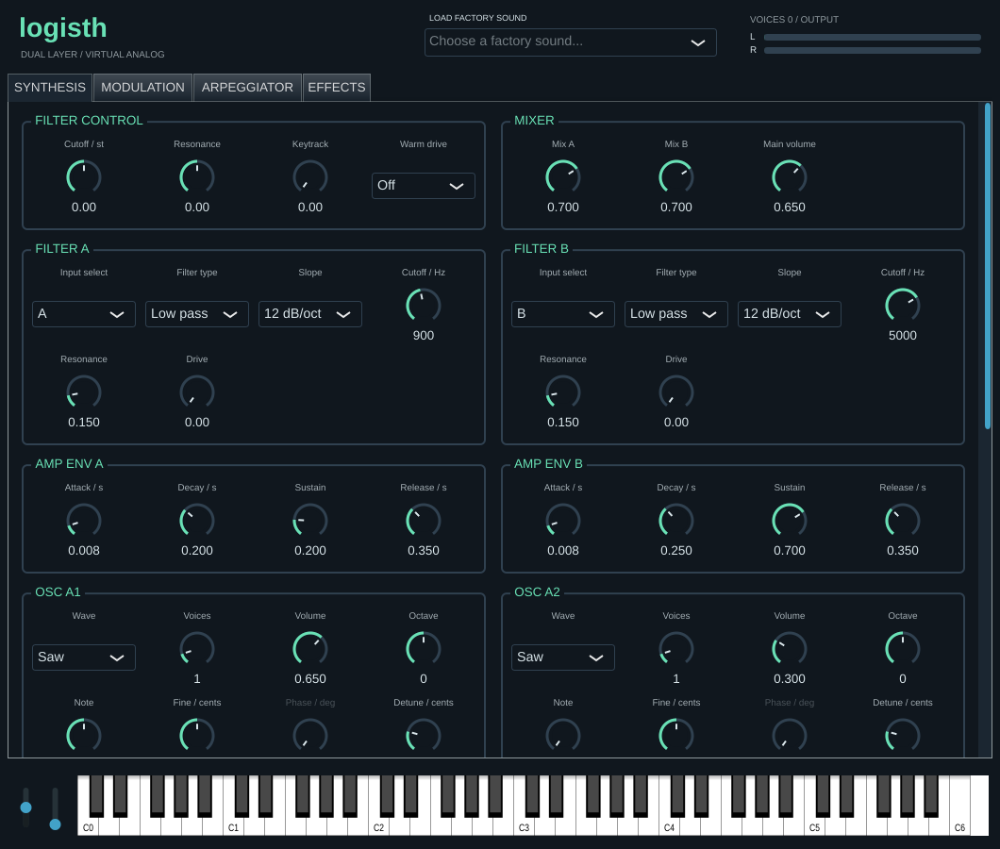

# logisth 0.2.0 — pliki do pobrania

- [Linux x86_64: VST3, CLAP i Standalone](logisth-0.2.0-linux-x86_64.tar.gz)
- [Kod źródłowy](logisth-0.2.0-source.tar.gz)
- [Próbka WAV](logisth-demo.wav)
- [Interfejs](logisth.png)
- [Synthesis](logisth-page-1.png), [Modulation](logisth-page-2.png),
  [Arpeggiator](logisth-page-3.png), [Effects](logisth-page-4.png)
- [Sumy SHA-256](SHA256SUMS)

Kliknij plik i wybierz pobranie pliku (Download raw file).
Te same pliki workflow Publish release umieszcza w wydaniu GitHub dla tagu
`v0.2.0`. Kompilacje Windows/macOS są przygotowywane przez workflow Build and test.

Binaria Linux wymagają glibc ≥2.38. VST2 nie jest dołączone — wymaga własnego SDK.
Lokalne testy: 6/6 zaliczone. [Uwagi do wydania](../../docs/RELEASE-v0.2.0.md).

